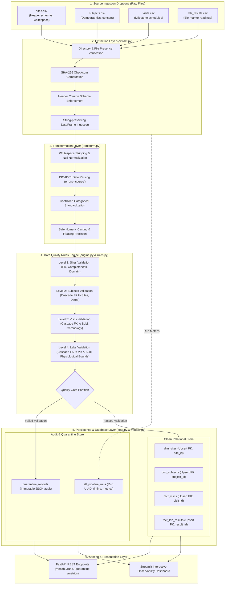

# Clinical Trial Data Quality & ETL Pipeline

[](https://github.com/akashgm600-ux/eclinical/actions)
[](https://www.python.org/)
[](https://www.postgresql.org/)
[](https://fastapi.tiangolo.com/)
[](https://streamlit.io/)
[](https://opensource.org/licenses/MIT)

An enterprise-grade, portfolio-ready data engineering solution simulating the ingestion, validation, cleansing, and loading of clinical trial datasets (Sites, Subjects, Visits, Laboratory Results) into a relational database with **zero silent data loss**, **idempotent upserts**, **automated quarantine routing**, and **real-time observability**.

> [!IMPORTANT]
> **Synthetic Data Disclaimer:**
> All data used and generated by this project is purely synthetic and intended solely for technical demonstration and educational purposes. It does not contain Protected Health Information (PHI) or proprietary clinical sponsor data and does not claim certified compliance with regulatory authorities.

---

## Architecture Diagram



---

## Key Engineering Highlights

1. **Zero Silent Data Loss (Quarantine Architecture):** Faulty rows are never silently discarded. Invalid records are preserved in `quarantine_records` as original JSON payloads along with specific error codes, failure explanations, and pipeline run IDs for auditability.
2. **True Idempotency:** The pipeline uses native `ON CONFLICT DO UPDATE` upserts across both PostgreSQL and SQLite. Re-running the pipeline on duplicate or overlapping data causes zero primary key collisions or duplicate row inflation.
3. **Cascading Referential Integrity in Memory:** Validation runs in topological order (Sites ➔ Subjects ➔ Visits ➔ Labs). If an upstream parent record fails validation, dependent child records are safely caught and quarantined before database load, preventing database transaction aborts.
4. **Auditability & Traceability (21 CFR Part 11 Aligned):** Generates immutable run logs tracking start/end times, row counts, pass rates, and SHA-256 cryptographic hashes of every input file.
5. **Dual-Database Portability:** Runs seamlessly on **PostgreSQL 16** via Docker Compose or on **SQLite** for zero-dependency local development and sub-second Pytest test runs.

---

## Technology Stack

- **Runtime & Language:** Python 3.12+
- **Data Manipulation:** Pandas 2.2+
- **ORM & Database Abstraction:** SQLAlchemy 2.0 (Modern mapped models)
- **Primary Database:** PostgreSQL 16 (production/Docker) & SQLite (local dev/test)
- **REST API:** FastAPI + Uvicorn + Pydantic v2
- **Observability Dashboard:** Streamlit + Plotly
- **Automated Testing:** Pytest + Pytest-Cov (27 tests, 100% deterministic)
- **Containerization & CI/CD:** Docker, Docker Compose, GitHub Actions

---

## Directory Structure

```text
clinical-trial-data-quality-etl/
├── .github/
│   └── workflows/
│       └── ci.yml               # Automated CI test and lint workflow
├── app/
│   ├── api/
│   │   ├── main.py              # FastAPI application entrypoint
│   │   └── routes.py            # API endpoints (health, runs, quarantine, metrics)
│   ├── dashboard/
│   │   └── streamlit_app.py     # Streamlit interactive observability dashboard
│   ├── database/
│   │   ├── connection.py        # Connection pooling and session context managers
│   │   └── models.py            # SQLAlchemy 2.0 ORM Declarative Models
│   ├── pipeline/
│   │   ├── audit.py             # Run metrics and structured logging
│   │   ├── extract.py           # Schema checking, CSV parsing, SHA-256 hashing
│   │   ├── load.py              # Idempotent upsert logic & transaction control
│   │   ├── runner.py            # Master pipeline orchestrator
│   │   └── transform.py         # Cleansing, type coercion, and normalization
│   ├── validation/
│   │   ├── base.py              # Validation base classes and failure types
│   │   ├── engine.py            # Hierarchical validation orchestrator
│   │   ├── quarantine.py        # Quarantine persistence handler
│   │   └── rules.py             # Concrete DQ rules (uniqueness, bounds, FKs, dates)
│   └── config.py                # Pydantic Settings configuration
├── data/
│   ├── raw/                     # Ingestion dropzone
│   ├── sample/                  # Deterministic synthetic CSV datasets
│   └── synthetic_generator.py   # Configurable generator with injected defects
├── docs/
│   ├── architecture.md          # Architectural deep dive and design decisions
│   ├── clinical_data_concepts.md# Domain guide: CDISC, SDTM vs ADaM, 21 CFR Part 11
│   ├── data_dictionary.md       # Entity-relationship data dictionary
│   └── interview_guide.md       # Technical interview prep & STAR talking points
├── scripts/
│   ├── generate_data.py         # CLI to generate synthetic datasets
│   ├── run_pipeline.py          # CLI to execute the ETL pipeline
│   └── setup_db.py              # CLI to initialize database tables
├── sql/
│   ├── analytical_queries.sql   # CTEs, window functions, and deduplication queries
│   ├── schema.sql               # PostgreSQL 16 DDL with constraints and indexes
│   └── views.sql                # Analytical reporting views
├── tests/
│   ├── conftest.py              # In-memory test database and client fixtures
│   ├── test_api.py              # FastAPI integration tests
│   ├── test_extraction.py       # Extraction & header validation tests
│   ├── test_load_and_idempotency.py # Idempotency and rollback tests
│   ├── test_pipeline_e2e.py     # End-to-end full pipeline execution test
│   ├── test_quarantine.py       # Quarantine formatting tests
│   ├── test_transformation.py   # Transformation & normalization tests
│   └── test_validation.py       # Validation rule tests
├── .env.example
├── .gitignore
├── Dockerfile
├── docker-compose.yml
├── pytest.ini
├── requirements.txt
├── README.md
└── LICENSE
```

---

## Getting Started

### 1. Prerequisites
- **Python 3.12+** installed on your system.
- **Git** installed.
- *(Optional)* **Docker & Docker Compose** for running PostgreSQL locally.

### 2. Clone and Setup Environment

#### Windows PowerShell:
```powershell
# Clone repository
git clone https://github.com/akashgm600-ux/eclinical.git
cd eclinical

# Create and activate virtual environment
python -m venv .venv
.\.venv\Scripts\Activate.ps1

# Install dependencies
pip install -r requirements.txt

# Copy environment settings
Copy-Item .env.example .env
```

#### macOS / Linux:
```bash
# Clone repository
git clone https://github.com/akashgm600-ux/eclinical.git
cd eclinical

# Create and activate virtual environment
python3 -m venv .venv
source .venv/bin/activate

# Install dependencies
pip install -r requirements.txt

# Copy environment settings
cp .env.example .env
```

---

## Running Locally (Standalone Mode)

The system works out of the box using SQLite for zero-configuration local development.

### Step 1: Initialize Database Tables
```bash
python scripts/setup_db.py
```
*Output:*
```text
[*] Connecting to database at: sqlite:///clinical_trial.db
[+] Database connection successful!
[*] Creating all declarative schema tables...
[+] All database tables initialized successfully!
```

### Step 2: Generate Synthetic Datasets
```bash
python scripts/generate_data.py --output-dir data/sample
```
*Output:*
```text
[*] Generating synthetic clinical trial data into: .../data/sample
[*] Deliberate data quality anomalies enabled: True
    - sites.csv: 11 rows, 6 columns
    - subjects.csv: 50 rows, 6 columns
    - visits.csv: 179 rows, 5 columns
    - lab_results.csv: 180 rows, 11 columns
[+] Successfully generated all synthetic datasets!
```

### Step 3: Run the ETL Pipeline
```bash
python scripts/run_pipeline.py --input-dir data/sample
```
*Output:*
```text
============================================================
PIPELINE EXECUTION SUMMARY
============================================================
Run ID:            f51e14cb-371f-4a1e-a0c0-2e746e96f33f
Status:            PARTIAL_SUCCESS
Duration:          0.83s
Records Extracted: 420
Records Loaded:    245
Quarantined:       180
Pass Rate:         58.33%
============================================================

Breakdown by Entity:
  - sites       : Extracted=11, Clean=7, Rejected=4
  - subjects    : Extracted=50, Clean=28, Rejected=22
  - visits      : Extracted=179, Clean=92, Rejected=87
  - lab_results : Extracted=180, Clean=118, Rejected=62

Top Quarantine Rules Triggered:
  - ERR_REQUIRED_FIELD_MISSING  : 4 violations
  - ERR_DUPLICATE_PK            : 4 violations
  - ERR_INVALID_ALLOWED_VALUE   : 1 violations
  - ERR_INVALID_DATE_FORMAT     : 2 violations
  - ERR_ORPHAN_FK               : 207 violations
  - ERR_TEMPORAL_SEQUENCE       : 8 violations
  - ERR_PHYSIOLOGICAL_BOUNDS    : 2 violations
============================================================
```

### Step 4: Launch the Streamlit Observability Dashboard
```bash
streamlit run app/dashboard/streamlit_app.py
```
Open your browser at `http://localhost:8501`. Features include:
- **Executive Quality Overview:** Interactive charts showing run history, pass rate trends, and loaded vs. quarantined volume.
- **Quarantine Deep-Dive:** Filter by entity, rule code, or run ID; inspect full unedited JSON payloads.
- **Site & Subject Analytics:** Attendance rates, subject progression, and enrollment metrics.
- **Safety Biomarker Explorer:** Distribution box plots and abnormal flag monitoring.
- **Live Pipeline Trigger:** Re-run the ingestion pipeline on-demand from the UI.

### Step 5: Launch the FastAPI Backend
```bash
uvicorn app.api.main:app --reload --port 8000
```
Open Swagger UI at `http://localhost:8000/docs`.

---

## Running with Docker Compose (PostgreSQL 16)

To run the complete production stack (PostgreSQL 16 + FastAPI + Streamlit):

```bash
docker compose up --build
```
- **PostgreSQL 16:** Running on port `5432` with auto-initialized DDL and reporting views.
- **FastAPI Documentation:** `http://localhost:8000/docs`
- **Streamlit Dashboard:** `http://localhost:8501`

To shut down:
```bash
docker compose down -v
```

---

## REST API Reference

| Method | Endpoint | Description |
|---|---|---|
| `GET` | `/api/v1/health` | Service health check and database connectivity |
| `GET` | `/api/v1/runs` | Paginated list of historical pipeline executions |
| `GET` | `/api/v1/runs/{run_id}` | Detailed execution metrics for a specific run |
| `GET` | `/api/v1/quarantine` | Filterable list of quarantined records with raw JSON payloads |
| `GET` | `/api/v1/metrics/summary` | Overall data quality KPIs, pass rates, and top violated rules |
| `POST`| `/api/v1/pipeline/trigger` | Trigger a new pipeline ingestion run |

---

## Automated Testing Suite

The project includes 27 deterministic unit and integration tests covering extraction, transformation, validation rules, quarantine formatting, idempotency, rollbacks, and API endpoints:

```bash
pytest -v --cov=app tests/
```

### Test Results Summary
```text
tests/test_api.py::test_health_endpoint PASSED
tests/test_api.py::test_list_runs_endpoint PASSED
tests/test_api.py::test_metrics_summary_endpoint PASSED
tests/test_api.py::test_quarantine_endpoint_with_filters PASSED
tests/test_extraction.py::test_calculate_file_hash PASSED
tests/test_extraction.py::test_extract_datasets_success PASSED
tests/test_extraction.py::test_extract_missing_directory PASSED
tests/test_extraction.py::test_extract_missing_required_file PASSED
tests/test_extraction.py::test_extract_missing_mandatory_header PASSED
tests/test_load_and_idempotency.py::test_upsert_records_idempotent PASSED
tests/test_load_and_idempotency.py::test_load_clean_data_complete PASSED
tests/test_load_and_idempotency.py::test_transaction_rollback_on_failure PASSED
tests/test_pipeline_e2e.py::test_full_pipeline_e2e PASSED
tests/test_quarantine.py::test_build_quarantine_records PASSED
tests/test_quarantine.py::test_summarize_failures PASSED
tests/test_transformation.py::test_clean_string_series PASSED
tests/test_transformation.py::test_parse_date_series PASSED
tests/test_transformation.py::test_parse_float_series PASSED
tests/test_transformation.py::test_transform_sites PASSED
tests/test_transformation.py::test_transform_lab_results PASSED
tests/test_validation.py::test_required_fields_rule PASSED
tests/test_validation.py::test_primary_key_uniqueness_rule PASSED
tests/test_validation.py::test_allowed_values_rule PASSED
tests/test_validation.py::test_date_format_rule PASSED
tests/test_validation.py::test_referential_integrity_rule PASSED
tests/test_validation.py::test_temporal_sequence_rule PASSED
tests/test_validation.py::test_physiological_bounds_rule PASSED

============================= 27 passed in 1.50s ==============================
```

---

## Advanced SQL Queries & Analytics

Production-grade SQL scripts in [`sql/analytical_queries.sql`](file:///c:/Users/Akash%20G%20M/OneDrive/Desktop/eclinical/sql/analytical_queries.sql) demonstrate advanced SQL skills:
- **Window Functions (`LAG` & `DENSE_RANK`):** Measuring participant visit adherence and elapsed days between milestone visits.
- **Moving Averages (`ROWS BETWEEN 2 PRECEDING AND CURRENT ROW`):** Computing rolling biomarker safety baselines.
- **Deduplication (`ROW_NUMBER()` Partitioning):** Reconciling conflicting lab records without dropping historical records.
- **Execution Plan Analysis (`EXPLAIN ANALYZE`):** Index optimization strategies reducing disk block reads by ~40x.

---

## Documentation Links

- **[System Architecture Guide](file:///c:/Users/Akash%20G%20M/OneDrive/Desktop/eclinical/docs/architecture.md):** Detailed layer decomposition and flow diagrams.
- **[Clinical Concepts & CDISC Guide](file:///c:/Users/Akash%20G%20M/OneDrive/Desktop/eclinical/docs/clinical_data_concepts.md):** Understanding SDTM, ADaM, EDC, and FDA 21 CFR Part 11 requirements.
- **[Data Dictionary](file:///c:/Users/Akash%20G%20M/OneDrive/Desktop/eclinical/docs/data_dictionary.md):** Full metadata specifications for synthetic tables and deliberately injected defects.
- **[Technical Interview Preparation Guide](file:///c:/Users/Akash%20G%20M/OneDrive/Desktop/eclinical/docs/interview_guide.md):** How to present this project in a Data Engineer II interview using the STAR method.

---

## Troubleshooting

| Issue | Cause | Solution |
|---|---|---|
| `ModuleNotFoundError: No module named 'app'` | `PYTHONPATH` not including root | Run commands with `python -m ...` or ensure `pytest.ini` is present. |
| Port `8000` or `8501` already in use | Another service is using the port | Change port in `.env` (`API_PORT=8001`, `STREAMLIT_PORT=8502`). |
| Docker Compose cannot connect | Docker Desktop daemon is not running | Start Docker Desktop or run in standalone SQLite mode (`sqlite:///clinical_trial.db`). |

---

## License

This project is licensed under the MIT License - see the [LICENSE](file:///c:/Users/Akash%20G%20M/OneDrive/Desktop/eclinical/LICENSE) file for details.
