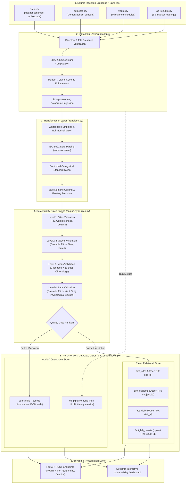

# System Architecture & Technical Design

This document details the software architecture, pipeline flow, transaction boundaries, and design trade-offs of the **Clinical Trial Data Quality & ETL Platform**.

---

## 1. System Architecture Overview



---

## 2. Layer-by-Layer Architectural Decomposition

### 2.1 Extraction Layer (`app/pipeline/extract.py`)
- **Schema Defense:** Checks for exact presence of expected mandatory headers before touching data. If a file is missing or has renamed columns, it raises a structured `ExtractionError` immediately.
- **Auditability via Checksums:** Computes a SHA-256 cryptographic digest of every incoming file. This provides immutable verification that source files have not been modified post-receipt.
- **String Preservation:** Reads CSV values initially with `dtype=str` and `keep_default_na=False` to prevent pandas from silently coercing data types (e.g., turning strings like `"00123"` into numbers `123` or parsing malformed dates prematurely).

### 2.2 Transformation Layer (`app/pipeline/transform.py`)
- **Whitespace & Null Standardizing:** Trims surrounding whitespace and converts string nulls (`""`, `"NA"`, `"null"`, `"None"`) into standard Python `None`.
- **Date Coercion:** Standardizes dates to ISO-8601 (`YYYY-MM-DD`). Corrupted dates (e.g. `2023-02-31`) are coerced to `NaT` rather than aborting the pipeline, allowing downstream rules to flag and quarantine them gracefully.
- **Categorical Casing:** Uppercases clinical status codes (`ACTIVE`, `ENROLLED`, `WITHDRAWN`, etc.) to reconcile casing discrepancies without data loss.

### 2.3 Data Quality & Validation Engine (`app/validation/`)
Validation is organized hierarchically to enforce relational consistency:
1. **Rule Classes:** Each rule extends `BaseRule` and produces a list of `ValidationFailure` dataclasses containing:
   - `source_entity` (e.g. `subjects`)
   - `record_identifier` (e.g. `SUBJ-8888`)
   - `raw_record_json` (unedited original JSON string)
   - `rule_code` (e.g. `ERR_ORPHAN_FK`)
   - `rule_name`
   - `error_message`
   - `severity` (`ERROR`)
2. **Cascading Referential Integrity:**
   - If a Site fails primary key validation (e.g. `SITE-1` duplicated), it is quarantined.
   - Any Subjects referencing `SITE-1` are subsequently caught by `ReferentialIntegrityRule` and quarantined to prevent database foreign key constraint crashes.
   - Any Visits or Labs referencing those quarantined Subjects are also safely quarantined.

### 2.4 Quarantine Architecture (`app/validation/quarantine.py`)
- **Zero Silent Data Drops:** Instead of using `.dropna()` or discarding invalid rows, failed rows are persisted to `quarantine_records`.
- **Preservation of Raw Inputs:** Quarantined rows store the raw payload as unedited JSON. This ensures that clinical data managers can investigate, reconcile, and re-inject corrected records.

### 2.5 Idempotent Persistence Layer (`app/pipeline/load.py`)
- **Upsert Semantics:** Uses PostgreSQL's native `ON CONFLICT (id) DO UPDATE` or SQLite's `insert().on_conflict_do_update()` to ensure that re-running the pipeline on duplicate or overlapping data does not cause primary key conflicts or row duplication.
- **Transaction Atomicity:** Loading of clean tables and quarantine records occurs within a single SQLAlchemy transaction scope. If a fatal crash occurs mid-flight, uncommitted records are rolled back cleanly.

---

## 3. Database Dialect Portability

The platform is designed to operate seamlessly across both **PostgreSQL 16** (production and Docker Compose) and **SQLite** (local zero-dependency development and sub-second Pytest test runs):

```
                         SQLAlchemy 2.0 ORM Engine
                                     │
                 ┌───────────────────┴───────────────────┐
                 ▼                                       ▼
        PostgreSQL 16 Dialect                     SQLite Dialect
   - Connection pooling (10/20)             - Zero-daemon standalone
   - Native ON CONFLICT DO UPDATE           - PRAGMA foreign_keys = ON
   - UUIDv4 native types                    - In-memory test execution
   - Docker Compose container               - Local single-file development
```
