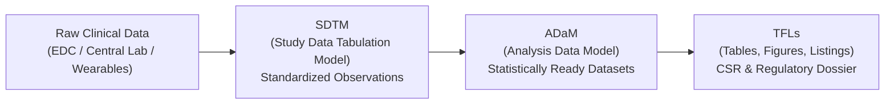

# Clinical Data Engineering: Core Concepts, Regulatory Standards, and CDISC

> [!IMPORTANT]
> **Educational Disclaimer:**
> This document is designed strictly for educational and portfolio presentation purposes to demonstrate domain fluency for clinical data engineering roles. The synthetic datasets and schemas in this project are illustrative simplified models and do NOT claim formal conformance or certification with regulatory agencies (FDA, EMA) or CDISC standards.

---

## 1. Fundamentals of Clinical Trials

A **clinical trial** is a prospective biomedical or behavioral research study of human subjects designed to evaluate the safety, efficacy, and pharmacological impact of medical countermeasures, drugs, biologics, or medical devices.

### Key Terminology

| Term | Full Name / Description | Role in Clinical Data Pipeline |
|---|---|---|
| **Protocol** | Clinical Study Protocol | The master scientific blueprint detailing objectives, design, methodology, visit schedules, eligibility criteria, and statistical analysis plans. |
| **Investigational Site** | Trial Research Facility | The physical hospital, university medical center, or private clinic conducting patient visits, assessments, and sample collection under GCP. |
| **PI** | Principal Investigator | The licensed medical doctor responsible for trial execution, patient safety, and data integrity at an individual investigative site. |
| **Subject / Participant** | Study Subject | An individual enrolled in the trial after signing Informed Consent. Identified in data solely via a de-identified unique subject identifier. |
| **EDC** | Electronic Data Capture | Software system (e.g., Medidata Rave, Veeva Vault) used by clinical site coordinators to record clinical observations into electronic CRFs. |
| **eCRF** | Electronic Case Report Form | Standardized digital forms capturing demographic, visit, medical history, adverse event, and laboratory data. |
| **eSource** | Electronic Source Data | Raw source data captured at point-of-care (e.g., EHR/EMR, direct central laboratory instrumentation feeds, wearables). |
| **AE / SAE** | Adverse Event / Serious AE | Any untoward medical occurrence in a patient administered a pharmaceutical product. SAEs require expedited regulatory notification. |

---

## 2. Regulatory Compliance: Why Auditability and Traceability Matter

Unlike consumer tech or standard web analytics, clinical trial data directly informs drug approval decisions that impact human life. Regulatory bodies (such as the **US FDA** and the **European EMA**) mandate rigorous legal frameworks:

### 2.1 21 CFR Part 11 (US FDA)
**Title 21 of the Code of Federal Regulations, Part 11** establishes criteria under which electronic records and electronic signatures are considered trustworthy, reliable, and legally equivalent to paper records.
- **Audit Trails:** Secure, computer-generated, time-stamped audit trails must independently record the date, time, user identity, and exact changes to any record without obscuring previous entries.
- **Data Integrity:** Systems must ensure that data cannot be altered, spoofed, or deleted unnoticed.
- **Validation:** Computerized systems processing clinical data must undergo formal IQ/OQ/PQ (Installation, Operational, Performance Qualification) to prove they do what they purport to do.

### 2.2 ALCOA+ Principles
The pharmaceutical gold standard for data governance:
- **A – Attributable:** Every data point must trace to its originator (who captured it, when, and on what device).
- **L – Legible:** Data and audit logs must remain readable throughout the 25+ year statutory retention period.
- **C – Contemporaneous:** Recorded at the exact moment the observation or calculation occurs.
- **O – Original:** The primary source record or a certified exact copy.
- **A – Accurate:** Free from errors, unvalidated rounding, or undocumented transformation.
- **+ Complete:** No silent drops; missing or quarantined values must be explicitly cataloged.
- **+ Consistent:** Applied without contradictions across visits and study phases.
- **+ Enduring:** Recorded on durable, version-controlled media.
- **+ Available:** Accessible to clinical monitors and FDA inspectors for review.

### 2.3 Why Silent Data Loss is Catastrophic
In ordinary web data pipelines, dropping invalid rows using `.dropna()` or ignoring unparseable dates might only alter a vanity metric by 0.01%. 

In a clinical trial:
1. **Safety Signals Disappear:** Dropping a row with an out-of-range lab result (e.g. `ALT = 9999 U/L` or `Hemoglobin = -12.0 g/dL`) could mask acute drug-induced liver injury or lethal toxicity.
2. **Regulatory Sanctions:** If an FDA inspector uncovers that an automated ETL pipeline discarded 50 unparseable rows without an audit log, the entire submission can be rejected via a **Complete Response Letter (CRL)** or **FDA Form 483 inspectional observation**.
3. **The Data Engineering Solution:** **Zero-Silent-Loss Quarantine Architecture**. Every malformed row is diverted to a dedicated, queryable quarantine table preserving the unedited raw JSON payload, exact timestamp, pipeline run ID, and diagnostic rule violation code.

---

## 3. CDISC Standards: SDTM vs ADaM

The **Clinical Data Interchange Standards Consortium (CDISC)** establishes global, vendor-neutral data standards required by the FDA (USA), PMDA (Japan), and NMPA (China) for regulatory submissions.

### 3.1 SDTM (Study Data Tabulation Model)
- **Purpose:** Standardizes the structure, variable naming, and controlled terminology for clinical study tabulations. It answers: *"What was observed and recorded during the trial?"*
- **Characteristics:**
  - One observation per row.
  - Divided into standard domains (2-character prefixes):
    - `DM` (Demographics)
    - `SV` (Subject Visits)
    - `LB` (Laboratory Test Results)
    - `AE` (Adverse Events)
    - `VS` (Vital Signs)
    - `CM` (Concomitant Medications)
  - Uses standard variable names: `USUBJID` (Unique Subject ID), `VISITNUM` (Visit Number), `LBDTC` (Lab Date/Time in ISO-8601), `LBSTRESC` (Standard Character Result), `LBSTRESN` (Standard Numeric Result).

### 3.2 ADaM (Analysis Data Model)
- **Purpose:** Derived datasets designed specifically for biostatisticians to execute clinical endpoints and statistical models without complex data manipulation during analysis. It answers: *"What is the scientific and clinical conclusion?"*
- **Characteristics:**
  - Built directly from SDTM domains.
  - Includes derived variables: baseline flags (`ABLFL`), change from baseline (`CHG`), percentage change from baseline (`PCHG`), treatment groups (`TRTP`, `TRTA`), and analysis flags.
  - Standard structures:
    - `ADSL` (Subject-Level Analysis Dataset – 1 row per subject, containing all baseline covariates).
    - `BDS` (Basic Data Structure – e.g. `ADLB` for lab parameters across time).
    - `OCCDS` (Occurrence Data Structure – e.g. `ADAE` for adverse event incidence).

### 3.3 Comparison Table

| Dimension | SDTM (Tabulation) | ADaM (Analysis) |
|---|---|---|
| **Primary Audience** | Data Managers, Regulators, Inspectors | Biostatisticians, Medical Writers |
| **Data Philosophy** | Pure, standardized observation record | Statistically derived and aggregated |
| **Derivations** | Minimal (unit standardizations, ISO-8601) | Extensive (baselines, deltas, flags, imputations) |
| **Traceability Requirement**| Must trace directly back to raw eCRF | Must trace mathematically back to SDTM |
| **Submission Output** | Define.xml + SAS Transport (XPT) / Dataset-JSON | Analysis-ready XPT files for FDA SAS programs |

---

## 4. How This Portfolio Project Maps to Clinical Practice

| Project Component | Clinical Trial Industry Analog | Industry Implementation |
|---|---|---|
| `dim_sites` | Site Management & Regulatory Master | Master site tracking in CTMS (Clinical Trial Management System) |
| `dim_subjects` | SDTM `DM` (Demographics) | Participant registry with informed consent tracking |
| `fact_visits` | SDTM `SV` (Subject Visits) | Milestone visit schedule tracking protocol adherence |
| `fact_lab_results` | SDTM `LB` (Laboratory Findings) | Central and local laboratory bio-marker feeds |
| `quarantine_records` | Data Queries / Discrepancy Management | EDC discrepancy workflows & Clinical Data Repository (CDR) quarantine |
| `etl_pipeline_runs` | GxP 21 CFR Part 11 Audit Trail | Automated ingestion ledger tracking batch hashes, timestamps, and row counts |
