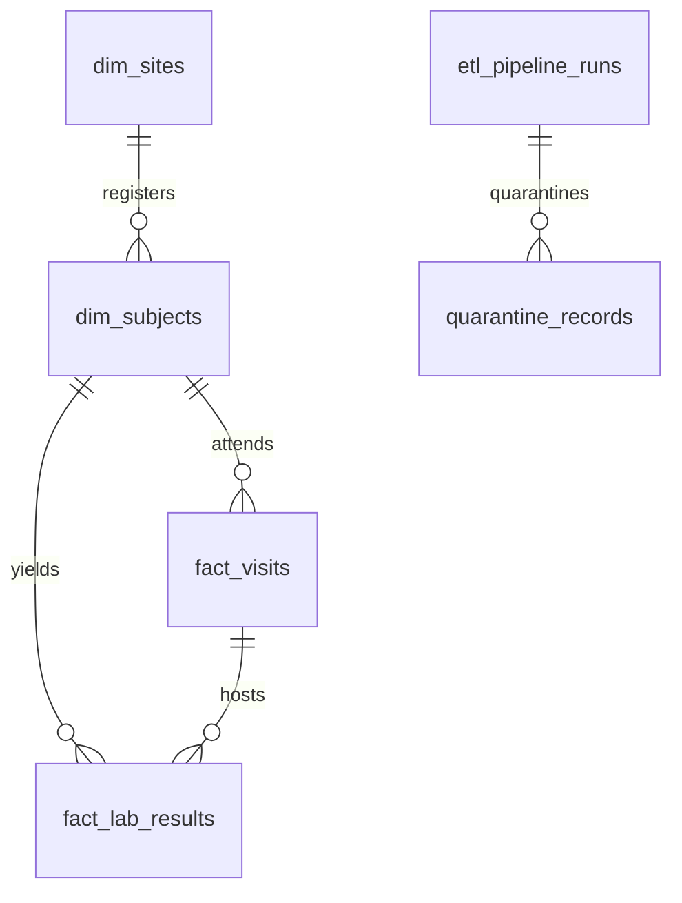

# Clinical Trial Data Platform: Synthetic Schema & Data Dictionary

This document details the data structures, entities, field definitions, and intentional data-quality anomalies contained in the synthetic clinical trial datasets.

> [!IMPORTANT]
> **Synthetic Data Disclaimer:**
> All data generated by this project is purely synthetic, created using mathematical distributions and programmatic rules. It does not represent real clinical trials, real patient records, or proprietary sponsor data. It is intended solely for demonstrating data engineering, ETL, quality gates, and database modeling capabilities.

---

## 1. Entity Relationship Overview

---

## 2. Dataset Specifications

### 2.1 Study Sites (`sites.csv` -> `dim_sites`)
Stores metadata regarding clinical trial investigation sites (hospitals, research clinics).

| Field Name | Data Type | Nullable | Primary / Foreign Key | Description | Example Values |
|---|---|---|---|---|---|
| `site_id` | String(50) | No | **Primary Key** | Unique business identifier for the trial site | `SITE-101`, `SITE-102` |
| `site_name` | String(255) | No | None | Official name of research institution or clinic | `Metropolitan Clinical Center 1` |
| `country` | String(100) | No | None | Country where site operates | `USA`, `Germany`, `Japan` |
| `investigator_name` | String(255) | Yes | None | Principal Investigator (PI) responsible for the site | `Dr. Eleanor Vance` |
| `activation_date` | Date (ISO-8601) | Yes | None | Date site was initiated and permitted to enroll patients | `2023-01-15` |
| `status` | String(50) | No | None | Operational status (`ACTIVE`, `CLOSED`, `SUSPENDED`) | `ACTIVE` |

**Deliberate Injected Anomalies:**
- Duplicate site entries with trailing/leading whitespace in site names.
- Invalid activation date formats (e.g. `2023-01-35`).
- Unrecognized status values (e.g. `PENDING_APPROVAL`).
- Missing mandatory `site_name` (`None`).

---

### 2.2 Study Subjects (`subjects.csv` -> `dim_subjects`)
Stores demographic and enrollment information for human participants in the trial.

| Field Name | Data Type | Nullable | Primary / Foreign Key | Description | Example Values |
|---|---|---|---|---|---|
| `subject_id` | String(50) | No | **Primary Key** | Unique participant identifier across the protocol | `SUBJ-1001`, `SUBJ-1002` |
| `site_id` | String(50) | No | **Foreign Key** (`dim_sites.site_id`) | Site where participant was screened and consented | `SITE-101` |
| `enrollment_date` | Date (ISO-8601) | No | None | Date informed consent was signed and participant was enrolled | `2023-03-12` |
| `date_of_birth` | Date (ISO-8601) | Yes | None | Participant birth date for age determination | `1980-05-12` |
| `gender` | String(20) | Yes | None | Biological sex (`M`, `F`, `OTHER`) | `F` |
| `status` | String(50) | No | None | Subject progression status (`ENROLLED`, `ACTIVE`, `COMPLETED`, `WITHDRAWN`, `SCREEN_FAIL`) | `ENROLLED` |

**Deliberate Injected Anomalies:**
- Orphan foreign key: `site_id` = `SITE-999` (does not exist in `dim_sites`).
- Duplicate subject identifiers (same `subject_id` submitted multiple times).
- Missing mandatory `site_id` (`None`).
- Impossible dates (e.g. `31/02/2023`).
- Dirty casing and padding in categorical values (e.g. `  enrolled  `).

---

### 2.3 Protocol Visits (`visits.csv` -> `fact_visits`)
Captures all planned protocol milestone visits and unplanned assessments.

| Field Name | Data Type | Nullable | Primary / Foreign Key | Description | Example Values |
|---|---|---|---|---|---|
| `visit_id` | String(50) | No | **Primary Key** | Unique identifier for the visit record | `VIS-5001`, `VIS-5002` |
| `subject_id` | String(50) | No | **Foreign Key** (`dim_subjects.subject_id`) | Participant who attended the visit | `SUBJ-1001` |
| `visit_name` | String(100) | No | None | Protocol visit name (`SCREENING`, `BASELINE`, `WEEK 4`, `WEEK 12`, `COMPLETION`) | `BASELINE` |
| `visit_date` | Date (ISO-8601) | No | None | Actual date the visit occurred | `2023-03-28` |
| `visit_status` | String(50) | No | None | Visit outcome (`ATTENDED`, `MISSED`, `CANCELLED`, `SCHEDULED`) | `ATTENDED` |

**Deliberate Injected Anomalies:**
- Chronological paradox: `visit_date` occurring 45 days *prior* to `enrollment_date`.
- Orphan foreign key: `subject_id` = `SUBJ-9999` (non-existent participant).
- Missing mandatory `visit_date` (`None`).
- Duplicate `visit_id` (`VIS-5002` submitted twice).

---

### 2.4 Laboratory Results (`lab_results.csv` -> `fact_lab_results`)
Quantitative measurements of blood and chemical bio-markers collected during visits.

| Field Name | Data Type | Nullable | Primary / Foreign Key | Description | Example Values |
|---|---|---|---|---|---|
| `result_id` | String(50) | No | **Primary Key** | Unique test result identifier | `LAB-9001` |
| `visit_id` | String(50) | No | **Foreign Key** (`fact_visits.visit_id`) | Visit during which sample was drawn | `VIS-5001` |
| `subject_id` | String(50) | No | **Foreign Key** (`dim_subjects.subject_id`) | Participant associated with specimen | `SUBJ-1001` |
| `test_code` | String(50) | No | None | Standard test abbreviation (`GLUC`, `HGB`, `ALT`, `AST`, `CREAT`) | `GLUC` |
| `test_name` | String(150) | No | None | Full test description | `Glucose, Fasting` |
| `result_value` | Float / Numeric | No | None | Measured quantitative value | `92.4` |
| `unit` | String(50) | No | None | Unit of measurement | `mg/dL` |
| `reference_low` | Float / Numeric | Yes | None | Lower normal reference boundary | `70.0` |
| `reference_high` | Float / Numeric | Yes | None | Upper normal reference boundary | `99.0` |
| `collection_date` | Date (ISO-8601) | No | None | Date sample was drawn | `2023-03-28` |
| `abnormal_flag` | String(20) | No | None | Automated evaluation (`NORMAL`, `HIGH`, `LOW`, `CRITICAL`) | `NORMAL` |

**Deliberate Injected Anomalies:**
- Biologically impossible negative values (e.g. Glucose = `-24.5 mg/dL`).
- Severe outlier data-entry error (e.g. Hemoglobin = `9999.0 g/dL`).
- Orphan foreign key: `visit_id` = `VIS-99999` (non-existent visit).
- Duplicate primary key: `LAB-9005` duplicated.

---

### 2.5 Quarantine Records (`quarantine_records`)
Captures all rows that failed any validation check, preserving the original raw payload for remediation and auditing.

| Field Name | Data Type | Nullable | Description | Example Values |
|---|---|---|---|---|
| `id` | Integer (Autoincrement) | No | Primary Key | `1`, `2` |
| `run_id` | String(64) | No | UUIDv4 referencing `etl_pipeline_runs.run_id` | `c873f550-96aa-4c2f-b48d-6a560c5dbbc2` |
| `source_entity` | String(50) | No | Table or entity being validated (`sites`, `subjects`, `visits`, `lab_results`) | `subjects` |
| `record_identifier` | String(100) | Yes | Identifier of the offending record if discernible | `SUBJ-8888` |
| `raw_record` | Text (JSON) | No | Complete raw row representation serialized as JSON | `{"subject_id": "SUBJ-8888", "site_id": "SITE-999", ...}` |
| `rule_code` | String(50) | No | Unique machine-readable rule code | `ERR_ORPHAN_FK` |
| `rule_name` | String(255) | No | Human-readable validation rule name | `Referential Integrity: Site FK Exists` |
| `error_message` | Text | No | Detailed explanation of why validation failed | `site_id 'SITE-999' does not exist in valid sites.` |
| `severity` | String(20) | No | Severity level (`ERROR`, `WARNING`) | `ERROR` |
| `quarantined_at` | Timestamp | No | System timestamp when record was diverted to quarantine | `2026-10-22 16:30:00` |

---

### 2.6 Pipeline Audit Runs (`etl_pipeline_runs`)
Maintains an immutable ledger of every ETL batch execution.

| Field Name | Data Type | Nullable | Description | Example Values |
|---|---|---|---|---|
| `run_id` | String(64) | No | Primary Key (UUIDv4) | `c873f550-96aa-4c2f-b48d-6a560c5dbbc2` |
| `pipeline_name` | String(100) | No | Name of the pipeline job | `clinical-trial-etl` |
| `pipeline_version` | String(50) | No | Software semantic version | `1.0.0` |
| `start_time` | Timestamp | No | Execution start time | `2026-10-22 16:29:00` |
| `end_time` | Timestamp | Yes | Execution completion time | `2026-10-22 16:29:05` |
| `status` | String(50) | No | Execution status (`STARTED`, `SUCCESS`, `PARTIAL_SUCCESS`, `FAILED`) | `PARTIAL_SUCCESS` |
| `records_extracted` | Integer | No | Total rows extracted across all input files | `420` |
| `records_loaded` | Integer | No | Total clean rows successfully upserted into database | `405` |
| `records_quarantined` | Integer | No | Total rows rejected and written to quarantine table | `15` |
| `execution_time_seconds` | Float | No | Total pipeline runtime in seconds | `1.84` |
| `error_summary` | Text | Yes | Top-level summary of failures if pipeline crashed | `None` |
